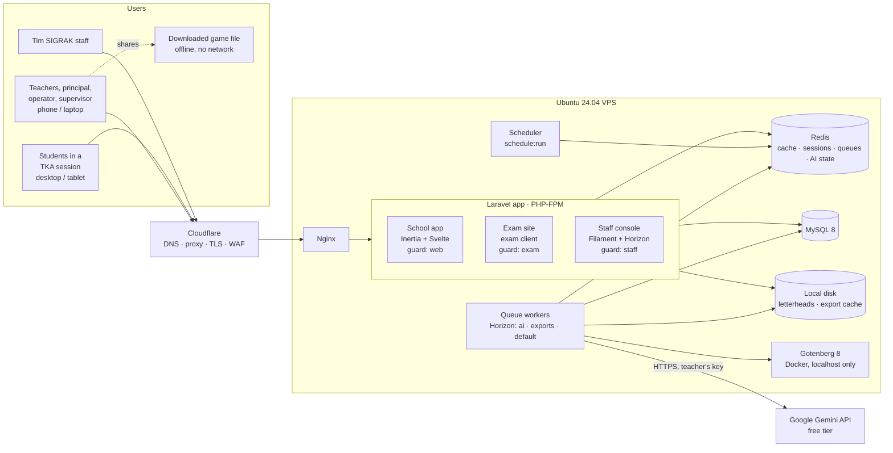
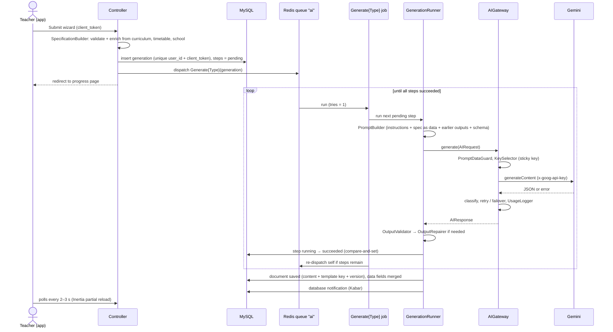
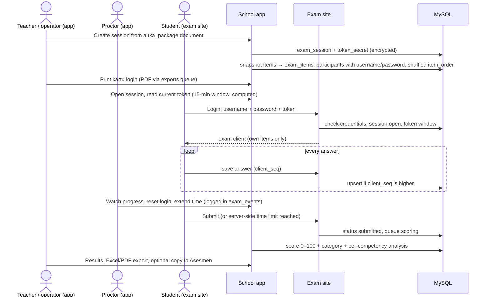

# Architecture Overview

- **Status:** draft
- **Task:** P2-04
- **Last updated:** 2026-10-30
- **Builds on:** [`product-concept.md`](product-concept.md), [`content-engine.md`](content-engine.md), [`ai-provider-engine.md`](ai-provider-engine.md), [`data-model.md`](data-model.md), [`religious-education.md`](religious-education.md), [`../agent/DECISIONS.md`](../agent/DECISIONS.md) (D-007…D-037)

## Purpose

This document shows how the parts of SIGRAK fit together, for developers starting Phase 3 work. It names each component once, draws the module boundaries in the code, walks through the four main flows, and describes the deployment and the security boundaries. Details stay in the documents linked above. Where this document has to choose something the drafts leave open, the choice is marked *proposed* and listed under [Decisions to record](#decisions-to-record).

Server installation steps belong to `server-setup.md` (P2-05). Code style belongs to `coding-standards.md` (P2-06).

## System at a glance

One Laravel application on one Ubuntu 24.04 VPS behind Cloudflare, reached only through a Cloudflare Tunnel (D-086, D-088). It serves three front ends on three hostnames, and each has its own login guard. Background work runs on Redis queues under Horizon. Gotenberg is the only Docker service. The only outside service the server calls is the Gemini API.



The exam site and its workers never call Gemini (D-027). Only jobs on the `ai` queue, and the key test in *Kunci AI Saya*, reach Google.

## Components

| Component | What it is | Runs as | Talks to | Source |
|---|---|---|---|---|
| **School app** | Every screen for teachers, principals, operators, supervisors. Inertia.js + plain Svelte, Tailwind with ported TailAdmin components, `lang/id` copy. Teacher menu: Hari Ini · Di Kelas · Buat · Asesmen · Kelas Saya, plus the role portals | PHP-FPM behind Nginx, Vite bundle | MySQL, Redis, local disk, queues | D-008, D-010, D-021 |
| **Di Kelas offline part** | Service worker and IndexedDB queue for Absensi, Jurnal, Catatan Siswa only | In the teacher's browser | Sync endpoint of the school app | D-016 |
| **Game runtime** | Vanilla JS + CSS bundle per game template (Quiz Battle in v1). Used by *Tayangkan* inside the app, and inlined into the *Unduh game* HTML file | Browser | Nothing (the downloaded file has a CSP that blocks all network) | D-011, D-015 |
| **Exam site** | The TKA practice exam client: question area, number grid, *ragu-ragu*, timer, font size. Separate bundle (`resources/exam-client/`) on its own subdomain | Same Laravel app, own route group and guard | Exam endpoints only | D-026, D-027 |
| **Staff console** | Filament panel for Tim SIGRAK: template registry and prompt overrides, schools and subscriptions, regional defaults, support, AI error overview. Horizon dashboard sits behind the same guard | Same Laravel app, own route group and guard | MySQL, Redis | D-010, D-013 |
| **MySQL 8** | The only system of record. Schema in [`data-model.md`](data-model.md) | systemd service on the VPS | — | D-007 |
| **Redis** | Cache, sessions, queues, Horizon metadata, and AI runtime state (round-robin counters, cooldowns, circuit state, per-teacher funnel) | systemd service on the VPS | — | D-003 |
| **Queue workers** | Horizon supervisors per queue: `ai` (generation jobs), `exports` (PDF, DOCX, Excel, game HTML), `default` (mail, notifications, scoring, imports) | Horizon under Supervisor (or systemd) | MySQL, Redis, Gotenberg, Gemini | [`ai-provider-engine.md`](ai-provider-engine.md#queues-and-progress) |
| **Scheduler** | `php artisan schedule:run` every minute: stuck-step sweeper, data pruning, exam housekeeping (see [Scheduled jobs](#scheduled-jobs)) | cron | MySQL, Redis | — |
| **Gotenberg 8** | Headless Chromium for HTML → PDF, called through `spatie/laravel-pdf` | Docker container, pinned image, bound to localhost, basic auth | Nothing outbound | D-028, D-031 |
| **Gemini API** | Google's `generateContent`, free tier, with each teacher's own keys | External | — | D-012, D-023 |
| **Cloudflare** | DNS, proxy, TLS, WAF in front of every hostname | External | Nginx | D-003 |
| **Telescope** | Request, query, and job inspector | Local and staging only, never public in production | — | D-003 |
| **Python (optional)** | Only for data work Laravel/Node cannot do well, in its own folder with pinned dependencies. No runtime role is planned | CLI | — | CONTEXT |

Libraries bundled into the front ends and PDF views (D-033): three.js, KaTeX, ApexCharts, Lucide icons, Plus Jakarta Sans, an Arabic font, and the bundled figure set (D-030). All are pinned and served from our own build, never a CDN.

### Hostnames (*proposed*)

| Hostname | Serves | Guard | Session cookie |
|---|---|---|---|
| `app.<domain>` | School app | `web` (`users`) | Own cookie, host-only |
| `ujian.<domain>` | Exam site | `exam` (`exam_participants`) | Own cookie, host-only |
| `admin.<domain>` | Staff console + Horizon | `staff` (`staff_users`) | Own cookie, host-only |

All three are route groups in one Laravel codebase (`Route::domain(...)`). Session cookies are **host-only** (no `SESSION_DOMAIN=.<domain>`), so a session on one hostname is never sent to another. A marketing site, if one is made, is a separate project (product concept, Access model).

## Module boundaries

The code is split by responsibility. The arrows are the only allowed dependencies; anything else is a review finding.

```
app/
├── AI/            Gemini only. Keys, selection, errors, privacy guard, usage logs.
│                  Knows nothing about education. Entry point: AIGateway.
├── Content/       Templates, generation pipeline, export. Knows nothing about Gemini.
│   ├── Templates/   one folder per content type (Rpm, BankSoal, Lkpd, QuizBattle, TkaPackage)
│   ├── Generation/  SpecificationBuilder, PromptBuilder, OutputValidator, OutputRepairer, GenerationRunner
│   └── Export/      PdfExporter, DocxExporter, ExcelExporter, GameExporter
├── Tenancy/       Current school context, BelongsToSchool scope, membership and role switch   (proposed)
├── Curriculum/    Import command, curriculum versions, school changes and validation          (proposed)
├── Classroom/     Di Kelas: attendance, journal, student notes, offline sync endpoint          (proposed)
├── Exam/          TKA sessions, snapshot, cards, token, exam client API, scoring              (proposed)
├── Filament/      Staff console resources only
└── Jobs/Generation/  GenerateRpm, GenerateBankSoal, GenerateLkpd, GenerateQuizBattle,
                      GenerateTkaPackage, ReviseSection (one job per content type, D-024)
```

`app/AI/` and `app/Content/` are fixed by the drafts. The other folder names are *proposed*; administration features without a strong boundary (assessment, report cards, portals, finance, inventory) stay in Laravel's default `Models`, `Http`, `Policies` layout until they grow.

| Module | May use | Must not use | Why |
|---|---|---|---|
| `AI` | Laravel HTTP client, Redis, `ai_*` tables | `Content`, `Exam`, student models | Keeps provider logic replaceable and testable with a fake (D-022 item 4) |
| `Content` | `AI` through `AIGateway` only, `Curriculum` (read), `Tenancy` | `AI` internals, Gemini types | Templates name a *purpose*, never a model |
| `Curriculum` | `Tenancy` | `AI`, `Content` | Pure reference data plus the validation flow (D-019) |
| `Classroom` | `Tenancy`, `Curriculum` (read), `Content` (read meetings for Jurnal) | `AI` | Offline data never touches AI |
| `Exam` | `Tenancy`, `Content` (read a `tka_package` document once, to snapshot it) | `AI`, anything after the snapshot | Exam isolation (D-027). A running exam reads only `exam_*` tables |
| `Filament` | Everything, with `withoutSchoolScope()` where needed | — | Staff tooling; the only place bypassing the scope is normal |

**Data that crosses a boundary is a snapshot.** Bank Soal items are copied into `assessment_items`; a TKA package is copied into `exam_items` when a session is scheduled; a generation stores its specification and step outputs. Later edits to the source never change a running exam or a past score.

## Main flows

### 1. Content generation



Key rules, all from [`ai-provider-engine.md`](ai-provider-engine.md) and [`content-engine.md`](content-engine.md#generation-pipeline):

- One job class per content type; they share `GenerationRunner`, `AIGateway`, the editor shell, and export (D-024).
- No queue-level retries. Retries, failover, cooldowns, and the circuit breaker live inside `AIGateway`. At most 4 attempts and 5 minutes per step.
- At most 2 running generations per teacher (`Redis::funnel`).
- Data fields (identity, CP, TP codes, meetings, minutes) are merged from the database after generation; AI output for them is ignored.
- *Perbaiki bagian ini* runs `ReviseSection` the same way, with the document's own template version, and keeps the previous content as a revision.

**Job uniqueness and self-re-dispatch (*proposed* detail).** The drafts say each job is `ShouldBeUnique` by generation id *and* re-dispatches itself. With plain `ShouldBeUnique` the lock is held until the job finishes, so the re-dispatch from inside `handle()` would be dropped. Use `ShouldBeUniqueUntilProcessing` (the lock is released when the job starts) together with the `WithoutOverlapping` job middleware keyed by generation id. Then a double dispatch is still blocked, two runs of one generation never overlap, and the next step can be queued.

### 2. Export (PDF, DOCX, Excel, game file)

1. The teacher presses *Unduh PDF/Word/Excel* or *Unduh game*. The controller checks `document_exports` for a row with the same `content_hash`, template version, and print settings. A hit is served straight from disk.
2. A miss queues an export job on `exports` and the page shows progress (same polling pattern as generation).
3. The job renders from the document's content JSON, never from a screenshot:
   - **PDF:** one Blade view per template → `spatie/laravel-pdf` → Gotenberg over `http://127.0.0.1` with basic auth. JavaScript runs before capture (`waitUntilReady`) so KaTeX, ApexCharts, and three.js render. The letterhead image (teacher's own, else the school's; D-031), print settings, and the Sigrak Dasar watermark are part of the view. One view → one PDF, no merging.
   - **DOCX:** PhpWord from SIGRAK's own layout per template, letterhead image in the header.
   - **Excel:** Laravel Excel, Indonesian headers through translation keys, numbers stored as numbers.
   - **Game HTML:** `GameExporter` inlines the runtime bundle of the document's template version, embeds content as escaped JSON, and adds the no-network CSP meta tag.
4. The file is stored on local disk, recorded in `document_exports`, and downloaded through an authorized route (never a public URL).

Exam cards and TKA result reports use the same path.

**Gotenberg gets everything it needs in the request (*proposed*).** The HTML, fonts, scripts, and images are sent as files in the multipart request (or inlined as `data:` URIs). The container has no route to the app and no outbound internet, so a malicious string in a document cannot make Chromium fetch anything.

### 3. Offline sync (Di Kelas)

```
Teacher phone                                         Server
─────────────                                         ──────
Open Di Kelas while online
  service worker caches the Di Kelas shell
  IndexedDB caches today's classes, students, slots  ◄── GET (session cookie)
Signal drops
  Absensi / Jurnal / Catatan Siswa saved to
  IndexedDB with a client_uuid, shown as
  "tersimpan di perangkat"
Signal returns (or app reopened)
  queue sent in batches ───────────────────────────►  POST /sync (session cookie + CSRF)
                                                       upsert by client_uuid
                                                       (unique; repeats are no-ops)
                                                       policy check per row
  rows marked sent      ◄───────────────────────────   per-row result
```

- Only Absensi, Jurnal, and Catatan Siswa work offline (D-016). Every other screen needs a connection.
- Last write wins per row; `recorded_at_device` keeps the device time next to the server timestamps.
- **Auth (*proposed*):** the sync endpoint uses the normal web session cookie and CSRF token, not a separate API token. The drafts keep the session alive (no 15-minute idle cut) and the app is same-origin, so no extra token type is needed. If the session has expired, queued rows stay in IndexedDB until the teacher logs in again; they are never dropped.
- **Device data (*proposed*):** cached student names and queued rows live only in IndexedDB for the logged-in teacher and are cleared on logout. Religion is not cached (it is not needed to take attendance; D-036).

### 4. TKA exam session



- The exam site reads only `exam_participants`, that participant's `exam_items`, and their own `exam_answers`. It shows the student's name and class, nothing else from `students` (never religion; D-036).
- Time is enforced on the server from `started_at`, `duration_minutes`, and `extra_minutes`. The client timer is display only.
- Answers autosave with a sequence number, so reconnects and retries are idempotent.
- Credentials stop working when the session is `closed`; passwords are purged 30 days later.
- Scoring follows [`content-engine.md`](content-engine.md#tka-practice-exam-cbt): partial credit for PGK forms, normalised to 0–100, shown as a practice estimate (D-030).

### Other flows (no new architecture)

These use the same building blocks and need no extra components:

- **Invitation and login:** operator invites → signed token (`token_hash`) by mail → user sets a password. Only login, invitation acceptance, and password reset are reachable without a session (D-010).
- **Curriculum import:** `php artisan curriculum:import <file>`, idempotent by `code` (D-020).
- **Curriculum validation:** guru → kepala sekolah → pengawas, append-only `curriculum_validations` (D-019).
- **Comments** by principal and supervisor on documents (D-019).
- **Report description drafts:** a generation whose input is anonymous per-TP mastery ("Murid A"); the name is merged after generation on the server.
- **Tayangkan:** a fullscreen route inside the teacher's session that loads the game runtime with the document's content. Scores stay on the device.
- **Template prompt override:** staff edit in Filament → new immutable `template_versions` row, no deploy (D-013).
- **RPM scheduling:** meetings are placed on the timetable; a journal entry marked "tidak terlaksana" shifts later meetings to the next slot (`meetings`, `meeting_schedule_history`).
- **Buka di Canva (level 1):** an export download plus a link that opens canva.com. No server call to Canva.
- **Kabar:** announcements, reminders, and database notifications (generation done, key invalid) in one inbox.
- **Plan limits:** a small entitlement check (monthly template limit, watermark, TKA sessions only on Sigrak Sekolah) read from `subscriptions` before a generation or export is queued.

## Deployment topology

Everything runs on one VPS. This is enough for the pilot and is the stated stack; scaling out is a later decision.

```
                    Internet
                       │
              ┌────────▼─────────┐
              │    Cloudflare    │  DNS, proxy (orange cloud), TLS, WAF
              └────────┬─────────┘
                       │ Cloudflare Tunnel (cloudflared, outbound only)
┌──────────────────────▼───────────────────────────────────────────────┐
│ Ubuntu Server 24.04 VPS · no public IP                               │
│                                                                      │
│  ufw: deny all incoming · SSH via tunnel + Cloudflare Access         │
│                                                                      │
│  Nginx 127.0.0.1:8080 ── real IP from CF-Connecting-IP (localhost)   │
│    │      app.<domain> · ujian.<domain> · admin.<domain>             │
│    ▼                                                                 │
│  PHP-FPM (Laravel) ──┬── MySQL 8        (localhost)                  │
│                      ├── Redis          (localhost)                  │
│                      └── storage/       (letterheads, exports)       │
│                                                                      │
│  Supervisor ── Horizon ── supervisors: ai · exports · default        │
│  cron ──────── php artisan schedule:run (every minute)               │
│  Docker ────── gotenberg:8.x (pinned)  127.0.0.1 only, basic auth    │
│                                                                      │
│  Outbound: generativelanguage.googleapis.com (Gemini), mail provider │
└──────────────────────────────────────────────────────────────────────┘

Build: Vite assets built in CI or locally, shipped as files. Node.js is not
needed on the server unless a runtime need appears (CONTEXT).
```

Notes:

- **Horizon queue settings.** Each queue's worker `timeout` is above the longest client timeout of its jobs (180 s for long RPM steps), and the Redis queue connection's `retry_after` is above that again, as the AI draft requires. The `ai` supervisor is separate so long AI calls never block exports or mail.
- **Redis separation (*proposed*).** Use separate Redis databases (or connections with prefixes) for `cache`, `session`, `queue`/Horizon, and AI state. Then `cache:clear` cannot wipe sessions, queued jobs, or key cooldowns.
- **Telescope** is not installed in the production build (or is disabled and unreachable). Horizon is reachable only on `admin.<domain>` behind the staff guard.
- **Cloudflare caching:** authenticated HTML is never cached (Laravel sends `private, no-store` for these pages). Only hashed Vite assets are cacheable.
- **Time:** the server and the database run in UTC; the app displays `Asia/Jakarta`. Gemini daily quotas reset at midnight Pacific (14:00 or 15:00 WIB), which the key page shows.

### Scheduled jobs

| Job | Frequency | Source |
|---|---|---|
| Stuck-step sweeper: resume generations whose step is `running` past timeout + margin, log the attempt as `unknown` | every minute | AI draft, duplicates rule 7 |
| Prune `document_revisions` beyond the last 10 per document | daily | data model |
| Prune `ai_usage_logs` detail rows past retention, keep monthly aggregates | daily | AI draft (*proposed* 180 days) |
| Purge `exam_participants.password` 30 days after the session closes | daily | data model |
| Close exam sessions past `closes_at`, force-submit open attempts | every minute | data model, content engine |
| Remove expired `ai_credential_cooldowns` mirror rows | hourly | data model |
| Export cache cleanup (files no longer referenced) | daily | *proposed* |
| Database and file backups | daily | *open question* |

## Security boundaries

| Boundary | Rule | Enforced by |
|---|---|---|
| **Three guards** | `web` (school users), `exam` (session-scoped participants), `staff` (Tim SIGRAK). Separate tables, separate hostnames, host-only session cookies. A school account can never become staff; a participant can never reach the app | Guards + route groups per domain (D-010, D-027) |
| **Login-only** | No public pages. Only login, invitation acceptance, and password reset without a session. Accounts by invitation only | Middleware on every route group (D-010) |
| **Tenancy** | `school_id` on every school-owned table. `BelongsToSchool` global scope from the current membership, fail-closed. `withoutSchoolScope()` only in the staff console and in jobs that name the school. Policies on every action. An IDOR test per resource | `app/Tenancy` + policies + feature tests ([data model](data-model.md#tenancy-and-access)) |
| **Roles** | From `school_memberships`, not a role column. Supervisors read across assigned schools only, read-only, and never see student-level rows | Policies, `supervisor_assignments` |
| **Sensitive student data** | Religion visible to the class's teachers, operator, principal only; hidden from supervisors; never in prompts, never on the exam site (D-036). BK notes: author, homeroom teacher, principal | Policies, `PromptDataGuard`, exam API resources |
| **AI keys** | Teacher-owned. Encrypted cast (APP_KEY, rotate with `APP_PREVIOUS_KEYS`), fingerprint for duplicates, last 4 for display. Write-only: never in Inertia props, never in logs, sent only as the `x-goog-api-key` header. Decrypted only in `ApiKeyManager`/`GeminiClient`. Only the owner's generations may use a key | `app/AI/KeyManager`, Telescope header hiding (D-012, D-023) |
| **Prompt privacy** | No student personal data in any prompt. Teacher notes and curriculum text go in delimited data blocks; instructions come only from the template; output accepted only through schema validation | `PromptDataGuard`, `PromptBuilder`, `OutputValidator` |
| **AI output in the UI** | Rendered as text (Svelte escaping, never `{@html}` on AI output). The game runtime uses `textContent` | Code review rule, game runtime |
| **Exam isolation** | The exam site never calls the AI, links nowhere into the app, and reads only the participant's own exam. Credentials are session-scoped and expire on close. Token is TOTP-style from an encrypted per-session secret | `app/Exam`, `exam` guard (D-027) |
| **Downloaded games** | Teaching content only, no student data, CSP blocks all network | `GameExporter` (D-011) |
| **Gotenberg** | Localhost only, basic auth, pinned image, no outbound network, all assets passed in the request | Docker network settings (D-028) |
| **Staff console** | Separate guard and table; Horizon gated to staff; Telescope never public in production | Filament panel config, Horizon gate |
| **Edge** | Cloudflare WAF and TLS; no public IP, traffic only through the Cloudflare Tunnel (D-088); Nginx restores the real client IP so Laravel's rate limits and logs see real addresses | Cloudflare, ufw, Nginx |

**Rate limits on the exam site (*proposed*).** A whole class signs in from one school network, so many students share one public IP. Login throttling on `ujian.<domain>` is keyed by session and username, not by IP alone, and Cloudflare bot or rate rules for that hostname must allow bursts of 30–40 logins from one IP within a few minutes.

## Decisions to record

New choices this document makes. They get numbered when the parallel work is integrated.

1. **One codebase, three hostnames, three guards.** School app, exam site, and staff console are domain-routed groups in one Laravel app (`app.`, `ujian.`, `admin.<domain>`), each with its own guard and a host-only session cookie. Reason: one deploy and one data model on one VPS, while keeping D-010 and D-027 isolation.
2. **Module folders beyond `app/AI` and `app/Content`:** `app/Tenancy`, `app/Curriculum`, `app/Classroom`, `app/Exam`, with the dependency rules in [Module boundaries](#module-boundaries). `Exam` and `Classroom` never depend on `AI`.
3. **Generation job uniqueness:** `ShouldBeUniqueUntilProcessing` plus `WithoutOverlapping` keyed by generation id, instead of plain `ShouldBeUnique`, so a job can re-dispatch itself for the next step (refines D-024 and the AI draft's queue rules).
4. **Offline sync uses the web session + CSRF**, not a separate API token. Queued rows survive an expired session until the next login. Cached student data is cleared on logout and excludes religion.
5. **Gotenberg is fed all assets in the request** and has no outbound network.
6. **Separate Redis databases** for cache, sessions, queues/Horizon, and AI state.
7. **Exam-site rate limits are keyed by session and username, not IP alone**, because a class shares one IP.
8. **Staff tools (Filament, Horizon) live on `admin.<domain>`** behind the `staff` guard.

## Open questions

- [ ] **Domain and hostnames.** Final domain (depends on the PDKI name check) and whether the names `app.`, `ujian.`, `admin.` are acceptable.
- [ ] **Mail provider** for invitations, password reset, and notifications (none is named in the drafts).
- [ ] **Backups.** Database and file backup schedule, retention, and where copies are kept (off the VPS). Not covered by any draft.
- [ ] **File storage.** Local disk on the VPS is assumed for letterheads and the export cache. Is off-site object storage wanted later?
- [ ] **Staging environment.** Telescope is "local/staging only", which implies a staging server. Is it a second VPS, or a second site on the same VPS?
- [ ] **Exam capacity target.** How many participants at once across all schools (for example, several schools running TKA practice in the same morning)? This sizes PHP-FPM workers, MySQL, and Redis on the single VPS.
- [ ] **Exam client technology.** The drafts say "separate bundle". Svelte without Inertia (JSON endpoints for autosave) is the natural fit; confirm.
- [ ] **Mode Contoh (demo mode).** Proposed as a seeded demo school tenant; does it allow AI calls (with the salesperson's own key) or only show prepared content?
- [ ] **Payment provider** for subscriptions (billing tables come in the billing task).
- [ ] **PWA install.** Should the school app be installable (manifest + icon) or only cache Di Kelas through the service worker?
- [ ] Open questions carried from the drafts that affect architecture: Gemini under-18 clause for a service with a student exam site (product concept), 429 detail fields and free-tier model list (AI draft), usage-log retention (AI draft, data model), supervisor `school_id` context for written reports (data model).
