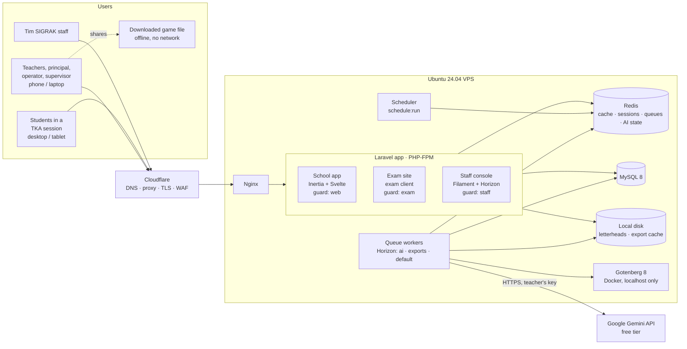
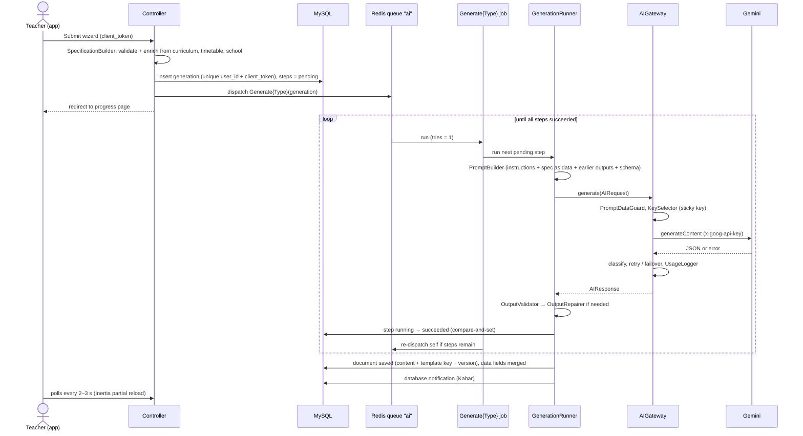
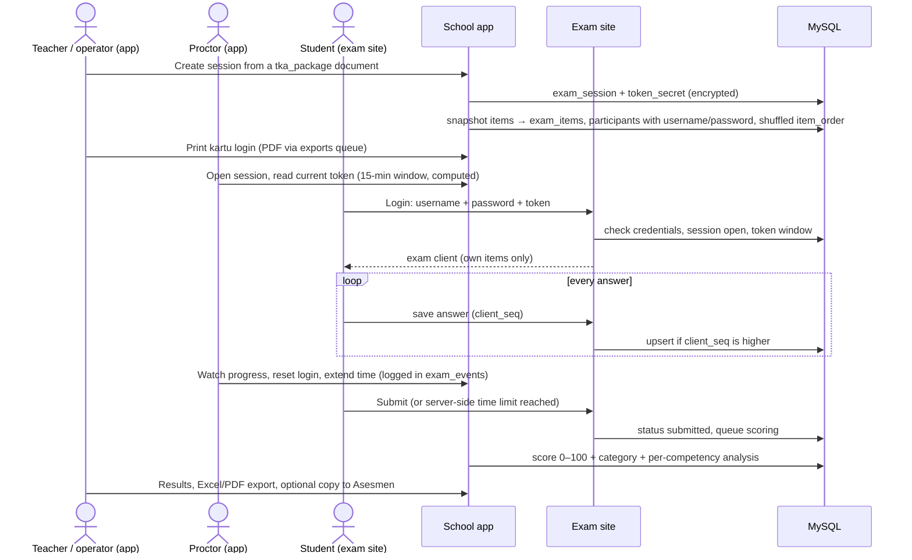

# Gambaran Arsitektur

<p class="source-note">Diterjemahkan dari <code>docs/final/architecture.md</code> pada 1 November 2026. Diagram di dalam blok kode dibiarkan apa adanya dan diikuti ringkasan berbahasa Indonesia.</p>

- **Status:** final (disetujui 2026-10-31, D-123)
- **Tugas:** P2-04
- **Terakhir diperbarui:** 2026-11-01
- **Melanjutkan:** `product-concept.md`, `content-engine.md`, `ai-provider-engine.md`, `data-model.md`, `religious-education.md`, `docs/agent/DECISIONS.md` (D-007…D-037)

## Tujuan

Dokumen ini menunjukkan bagaimana bagian-bagian SIGRAK saling terhubung, untuk pengembang yang memulai pekerjaan Fase 3. Dokumen ini menyebut setiap komponen sekali, menggambar batas modul di kode, menelusuri empat alur utama, dan menjelaskan deployment serta batas keamanan. Rinciannya tetap di dokumen yang ditautkan di atas. Bila dokumen ini harus memilih sesuatu yang dibiarkan terbuka oleh draf, pilihannya ditandai *usulan* dan dicantumkan di Keputusan untuk dicatat.

Langkah instalasi server ada di `server-setup.md` (P2-05). Gaya kode ada di `coding-standards.md` (P2-06).

## Sekilas sistem

Satu aplikasi Laravel di satu VPS Ubuntu 24.04 di balik Cloudflare, yang hanya bisa dijangkau lewat Cloudflare Tunnel (D-086, D-088). Aplikasi ini melayani tiga front end di tiga hostname, dan masing-masing punya guard login sendiri. Pekerjaan latar belakang berjalan di antrean Redis di bawah Horizon. Gotenberg satu-satunya layanan Docker. Satu-satunya layanan luar yang dipanggil server adalah Gemini API.



Ringkasan diagram: guru, kepala sekolah, operator, dan pengawas (ponsel/laptop), siswa dalam sesi TKA (desktop/tablet), dan staf Tim SIGRAK masuk lewat Cloudflare ke Nginx di VPS. Nginx meneruskan ke aplikasi Laravel yang berisi aplikasi sekolah (guard `web`), situs ujian (guard `exam`), dan konsol staf (guard `staff`). Aplikasi dan worker antrean memakai Redis, MySQL 8, dan disk lokal; worker juga memanggil Gotenberg dan, dengan kunci milik guru, Google Gemini API. Berkas game yang diunduh berjalan offline tanpa jaringan.

Situs ujian dan worker-nya tidak pernah memanggil Gemini (D-027). Hanya job di antrean `ai`, dan uji kunci di *Kunci AI Saya*, yang menjangkau Google.

## Komponen

| Komponen | Apa itu | Berjalan sebagai | Berhubungan dengan | Sumber |
|---|---|---|---|---|
| **Aplikasi sekolah** | Semua layar untuk guru, kepala sekolah, operator, pengawas. Inertia.js + Svelte biasa, Tailwind dengan komponen TailAdmin yang diporting, teks dari `lang/id`. Menu guru: Hari Ini · Di Kelas · Buat · Asesmen · Kelas Saya, ditambah portal per peran | PHP-FPM di balik Nginx, bundel Vite | MySQL, Redis, disk lokal, antrean | D-008, D-010, D-021 |
| **Bagian offline Di Kelas** | Service worker dan antrean IndexedDB khusus Absensi, Jurnal, Catatan Siswa | Di browser guru | Endpoint sinkronisasi aplikasi sekolah | D-016 |
| **Runtime game** | Bundel vanilla JS + CSS per templat game (Quiz Battle di v1). Dipakai *Tayangkan* di dalam aplikasi, dan disisipkan ke berkas HTML *Unduh game* | Browser | Tidak ada (berkas yang diunduh punya CSP yang memblokir semua jaringan) | D-011, D-015 |
| **Situs ujian** | Klien ujian latihan TKA: area soal, kisi nomor, *ragu-ragu*, timer, ukuran huruf. Entry Inertia + Svelte sendiri (`resources/exam-client/`, D-094) di subdomain sendiri, tanpa berbagi bundel dengan aplikasi sekolah | Aplikasi Laravel yang sama, kelompok rute dan guard sendiri | Hanya endpoint ujian | D-026, D-027 |
| **Konsol staf** | Panel Filament untuk Tim SIGRAK: registri templat dan override prompt, sekolah dan langganan, bawaan per daerah, dukungan, ringkasan galat AI. Dasbor Horizon ada di balik guard yang sama | Aplikasi Laravel yang sama, kelompok rute dan guard sendiri | MySQL, Redis | D-010, D-013 |
| **MySQL 8** | Satu-satunya sumber data resmi. Skema di `data-model.md` | Layanan systemd di VPS | — | D-007 |
| **Redis** | Cache, sesi, antrean, metadata Horizon, dan keadaan runtime AI (penghitung round robin, cooldown, keadaan circuit, corong per guru) | Layanan systemd di VPS | — | D-003 |
| **Worker antrean** | Supervisor Horizon per antrean: `ai` (job pembuatan), `exports` (PDF, DOCX, Excel, HTML game), `default` (email, notifikasi, penilaian, impor) | Horizon di bawah Supervisor (atau systemd) | MySQL, Redis, Gotenberg, Gemini | `ai-provider-engine.md` (bagian Antrean dan kemajuan) |
| **Scheduler** | `php artisan schedule:run` setiap menit: penyapu langkah tertahan, pemangkasan data, pemeliharaan ujian (lihat Job terjadwal) | cron | MySQL, Redis | — |
| **Gotenberg 8** | Chromium headless untuk HTML → PDF, dipanggil lewat `spatie/laravel-pdf` | Container Docker, image dikunci, terikat ke localhost, basic auth | Tidak ada koneksi keluar | D-028, D-031 |
| **Gemini API** | `generateContent` Google, paket gratis, dengan kunci milik masing-masing guru | Eksternal | — | D-012, D-023 |
| **Cloudflare** | DNS, proxy, TLS, WAF di depan setiap hostname | Eksternal | Nginx | D-003 |
| **Telescope** | Pemeriksa request, query, dan job | Hanya lokal dan staging, tidak pernah publik di produksi | — | D-003 |
| **Python (opsional)** | Hanya untuk pekerjaan data yang tidak bisa dikerjakan Laravel/Node dengan baik, di folder sendiri dengan dependensi terkunci. Tidak ada peran saat berjalan yang direncanakan | CLI | — | CONTEXT |

Pustaka yang dibundel ke front end dan view PDF (D-033): three.js, KaTeX, ApexCharts, ikon Lucide, Plus Jakarta Sans, font Arab, dan set gambar yang dibundel (D-030). Semuanya dikunci versinya dan disajikan dari build kita sendiri, tidak pernah dari CDN.

### Hostname (*usulan*)

| Hostname | Melayani | Guard | Cookie sesi |
|---|---|---|---|
| `app.<domain>` | Aplikasi sekolah | `web` (`users`) | Cookie sendiri, host-only |
| `ujian.<domain>` | Situs ujian | `exam` (`exam_participants`) | Cookie sendiri, host-only |
| `admin.<domain>` | Konsol staf + Horizon | `staff` (`staff_users`) | Cookie sendiri, host-only |

Ketiganya kelompok rute dalam satu codebase Laravel (`Route::domain(...)`). Cookie sesi bersifat **host-only** (tanpa `SESSION_DOMAIN=.<domain>`), sehingga sesi di satu hostname tidak pernah dikirim ke hostname lain. Situs pemasaran, bila dibuat, adalah proyek terpisah (konsep produk, Model akses).

## Batas modul

Kode dipisah berdasarkan tanggung jawab. Panah adalah satu-satunya dependensi yang diizinkan; selain itu menjadi temuan review.

```
app/
├── AI/            Gemini only. Keys, selection, errors, privacy guard, usage logs.
│                  Knows nothing about education. Entry point: AIGateway.
├── Content/       Templates, generation pipeline, export. Knows nothing about Gemini.
│   ├── Templates/   one folder per content type (Rpm, BankSoal, Lkpd, QuizBattle, TkaPackage)
│   ├── Generation/  SpecificationBuilder, PromptBuilder, OutputValidator, OutputRepairer, GenerationRunner
│   └── Export/      PdfExporter, DocxExporter, ExcelExporter, GameExporter
├── Tenancy/       Current school context, BelongsToSchool scope, membership and role switch   (proposed)
├── Curriculum/    Import command, curriculum versions, school changes and validation          (proposed)
├── Classroom/     Di Kelas: attendance, journal, student notes, offline sync endpoint          (proposed)
├── Exam/          TKA sessions, snapshot, cards, token, exam client API, scoring              (proposed)
├── Filament/      Staff console resources only
└── Jobs/Generation/  GenerateRpm, GenerateBankSoal, GenerateLkpd, GenerateQuizBattle,
                      GenerateTkaPackage, ReviseSection (one job per content type, D-024)
```

Ringkasan susunan folder: `AI/` hanya untuk Gemini (kunci, pemilihan, galat, penjaga privasi, log pemakaian; pintu masuknya `AIGateway`) dan tidak tahu apa pun tentang pendidikan. `Content/` berisi templat, pipeline pembuatan, dan ekspor, dan tidak tahu apa pun tentang Gemini. `Tenancy/`, `Curriculum/`, `Classroom/` (Di Kelas dan sinkronisasi offline), dan `Exam/` (sesi TKA, kartu, token, penilaian) adalah usulan. `Filament/` hanya berisi resource konsol staf, dan `Jobs/Generation/` berisi satu job per jenis konten (D-024).

`app/AI/` dan `app/Content/` sudah ditetapkan oleh draf. Nama folder lainnya *usulan*; fitur administrasi tanpa batas yang kuat (asesmen, rapor, portal, keuangan, inventaris) tetap di susunan bawaan Laravel `Models`, `Http`, `Policies` sampai fiturnya membesar.

| Modul | Boleh memakai | Tidak boleh memakai | Alasan |
|---|---|---|---|
| `AI` | Klien HTTP Laravel, Redis, tabel `ai_*` | `Content`, `Exam`, model siswa | Logika penyedia tetap bisa diganti dan dites dengan penyedia palsu (D-022 butir 4) |
| `Content` | `AI` hanya lewat `AIGateway`, `Curriculum` (baca), `Tenancy` | Bagian dalam `AI`, tipe Gemini | Templat menyebut *purpose*, tidak pernah model |
| `Curriculum` | `Tenancy` | `AI`, `Content` | Data rujukan murni ditambah alur validasi (D-019) |
| `Classroom` | `Tenancy`, `Curriculum` (baca), `Content` (membaca pertemuan untuk Jurnal) | `AI` | Data offline tidak pernah menyentuh AI |
| `Exam` | `Tenancy`, `Content` (membaca dokumen `tka_package` sekali, untuk dibuat snapshot) | `AI`, apa pun setelah snapshot | Isolasi ujian (D-027). Ujian yang berjalan hanya membaca tabel `exam_*` |
| `Filament` | Semuanya, dengan `withoutSchoolScope()` bila perlu | — | Alat staf; satu-satunya tempat melewati scope dianggap wajar |

**Data yang melintasi batas berupa snapshot.** Butir Bank Soal disalin ke `assessment_items`; paket TKA disalin ke `exam_items` saat sesi dijadwalkan; sebuah generation menyimpan spesifikasi dan keluaran langkahnya. Perubahan sumber di kemudian hari tidak pernah mengubah ujian yang sedang berjalan atau nilai yang sudah lewat.

## Alur utama

### 1. Pembuatan konten



Ringkasan diagram: guru mengirim wizard beserta `client_token`. Controller menyusun spesifikasi, menyimpan generation dengan langkah `pending`, mengirim job `Generate{Type}` ke antrean `ai`, lalu mengarahkan guru ke halaman kemajuan. Job menjalankan satu langkah tertunda lewat `GenerationRunner`: prompt disusun, `AIGateway` memeriksa privasi dan memilih kunci (lengket), memanggil Gemini, mengklasifikasi galat, mengulang atau failover, dan mencatat pemakaian. Keluaran divalidasi (diperbaiki bila perlu), langkah ditandai berhasil dengan compare-and-set, dan job mengirim ulang dirinya selama masih ada langkah. Setelah selesai, dokumen disimpan dengan kolom data digabungkan, notifikasi masuk ke *Kabar*, sementara halaman guru melakukan polling setiap 2–3 detik.

Aturan utama, semuanya dari `ai-provider-engine.md` dan `content-engine.md` (bagian Pipeline pembuatan):

- Satu kelas job per jenis konten; semuanya berbagi `GenerationRunner`, `AIGateway`, kerangka penyunting, dan ekspor (D-024).
- Tanpa percobaan ulang di tingkat antrean. Percobaan ulang, failover, cooldown, dan circuit breaker ada di dalam `AIGateway`. Paling banyak 4 percobaan dan 5 menit per langkah.
- Paling banyak 2 pembuatan berjalan per guru (`Redis::funnel`).
- Kolom data (identitas, CP, kode TP, pertemuan, menit) digabungkan dari database setelah pembuatan; keluaran AI untuk kolom itu diabaikan.
- *Perbaiki bagian ini* menjalankan `ReviseSection` dengan cara yang sama, dengan versi templat dokumen itu sendiri, dan menyimpan konten sebelumnya sebagai revisi.

**Keunikan job dan pengiriman ulang diri sendiri (rincian *usulan*).** Draf menyebut setiap job bersifat `ShouldBeUnique` berdasarkan id generation *dan* mengirim ulang dirinya. Dengan `ShouldBeUnique` biasa, kunci dipegang sampai job selesai, sehingga pengiriman ulang dari dalam `handle()` akan dibuang. Pakai `ShouldBeUniqueUntilProcessing` (kunci dilepas saat job mulai) bersama middleware job `WithoutOverlapping` dengan key id generation. Dengan begitu pengiriman ganda tetap diblokir, dua jalannya satu generation tidak pernah tumpang tindih, dan langkah berikutnya bisa diantrekan.

### 2. Ekspor (PDF, DOCX, Excel, berkas game)

1. Guru menekan *Unduh PDF/Word/Excel* atau *Unduh game*. Controller memeriksa `document_exports` untuk baris dengan `content_hash`, versi templat, dan pengaturan cetak yang sama. Bila ada, berkas langsung disajikan dari disk.
2. Bila tidak ada, job ekspor diantrekan di `exports` dan halaman menampilkan kemajuan (pola polling yang sama seperti pembuatan).
3. Job membuat berkas dari JSON konten dokumen, tidak pernah dari tangkapan layar:
   - **PDF:** satu view Blade per templat → `spatie/laravel-pdf` → Gotenberg lewat `http://127.0.0.1` dengan basic auth. JavaScript berjalan sebelum ditangkap (`waitUntilReady`) agar KaTeX, ApexCharts, dan three.js tampil. Gambar kop (milik guru, atau milik sekolah bila tidak ada; D-031), pengaturan cetak, dan watermark Sigrak Dasar menjadi bagian view. Satu view → satu PDF, tanpa penggabungan.
   - **DOCX:** PhpWord dari tata letak SIGRAK sendiri per templat, gambar kop di header.
   - **Excel:** Laravel Excel, judul kolom berbahasa Indonesia lewat key terjemahan, angka disimpan sebagai angka.
   - **HTML game:** `GameExporter` menyisipkan bundel runtime dari versi templat dokumen, menyematkan konten sebagai JSON yang di-escape, dan menambahkan tag meta CSP tanpa jaringan.
4. Berkas disimpan di disk lokal, dicatat di `document_exports`, dan diunduh lewat rute yang terotorisasi (tidak pernah URL publik).

Kartu ujian dan laporan hasil TKA memakai jalur yang sama.

**Gotenberg menerima semua yang dibutuhkannya di dalam request (*usulan*).** HTML, font, skrip, dan gambar dikirim sebagai berkas dalam request multipart (atau disisipkan sebagai URI `data:`). Container tidak punya rute ke aplikasi dan tidak punya internet keluar, sehingga string berbahaya di sebuah dokumen tidak bisa membuat Chromium mengambil apa pun.

### 3. Sinkronisasi offline (Di Kelas)

```
Teacher phone                                         Server
─────────────                                         ──────
Open Di Kelas while online
  service worker caches the Di Kelas shell
  IndexedDB caches today's classes, students, slots  ◄── GET (session cookie)
Signal drops
  Absensi / Jurnal / Catatan Siswa saved to
  IndexedDB with a client_uuid, shown as
  "tersimpan di perangkat"
Signal returns (or app reopened)
  queue sent in batches ───────────────────────────►  POST /sync (session cookie + CSRF)
                                                       upsert by client_uuid
                                                       (unique; repeats are no-ops)
                                                       policy check per row
  rows marked sent      ◄───────────────────────────   per-row result
```

Ringkasan diagram: saat online, service worker menyimpan kerangka Di Kelas dan IndexedDB menyimpan kelas, siswa, dan slot hari itu. Saat sinyal hilang, Absensi, Jurnal, dan Catatan Siswa disimpan di IndexedDB dengan `client_uuid` dan ditampilkan sebagai "tersimpan di perangkat". Saat sinyal kembali, antrean dikirim bertahap ke `POST /sync` (cookie sesi + CSRF); server melakukan upsert berdasarkan `client_uuid`, memeriksa policy per baris, dan mengembalikan hasil per baris sehingga perangkat menandai baris sebagai terkirim.

- Hanya Absensi, Jurnal, dan Catatan Siswa yang bekerja offline (D-016). Layar lain butuh koneksi.
- Penulisan terakhir yang menang per baris; `recorded_at_device` menyimpan waktu perangkat di samping timestamp server.
- **Autentikasi (*usulan*):** endpoint sinkronisasi memakai cookie sesi web biasa dan token CSRF, bukan token API terpisah. Draf menjaga sesi tetap hidup (tanpa pemutusan setelah 15 menit diam) dan aplikasinya satu origin, jadi tidak perlu jenis token tambahan. Bila sesi sudah habis, baris yang mengantre tetap di IndexedDB sampai guru masuk lagi; baris itu tidak pernah dibuang.
- **Data di perangkat (*usulan*):** nama siswa yang disimpan dan baris yang mengantre hanya ada di IndexedDB untuk guru yang sedang masuk, dan dihapus saat keluar. Agama tidak disimpan (tidak diperlukan untuk absensi; D-036).

### 4. Sesi ujian TKA



Ringkasan diagram: guru atau operator membuat sesi dari dokumen `tka_package`; aplikasi menyimpan sesi dengan `token_secret` terenkripsi, membuat snapshot butir ke `exam_items`, serta membuat peserta dengan nama pengguna, kata sandi, dan urutan butir acak. Guru mencetak kartu login. Proktor membuka sesi dan membaca token yang berlaku (jendela 15 menit). Siswa masuk ke situs ujian dengan nama pengguna, kata sandi, dan token; setiap jawaban disimpan dengan `client_seq`. Proktor memantau, mereset login, atau menambah waktu (dicatat di `exam_events`). Setelah siswa mengirim jawaban atau waktu habis, nilai 0–100, kategori, dan analisis per kompetensi dihitung, lalu guru melihat hasil, mengekspornya, atau menyalinnya ke Asesmen.

- Situs ujian hanya membaca `exam_participants`, `exam_items` milik peserta itu, dan `exam_answers` miliknya sendiri. Situs ini menampilkan nama dan kelas siswa, tanpa data lain dari `students` (tidak pernah agama; D-036).
- Waktu ditegakkan di server dari `started_at`, `duration_minutes`, dan `extra_minutes`. Timer di klien hanya tampilan.
- Jawaban tersimpan otomatis dengan nomor urut, sehingga sambung ulang dan pengiriman ulang bersifat idempoten.
- Kredensial tidak berlaku lagi saat sesi `closed`; kata sandi dihapus 30 hari kemudian.
- Penilaian mengikuti `content-engine.md` (bagian Ujian latihan TKA): nilai sebagian untuk bentuk PGK, dinormalkan ke 0–100, ditampilkan sebagai perkiraan latihan (D-030).

### Alur lain (tanpa arsitektur baru)

Alur berikut memakai blok bangunan yang sama dan tidak butuh komponen tambahan:

- **Undangan dan login:** operator mengundang → token bertanda tangan (`token_hash`) lewat email → pengguna mengatur kata sandi. Hanya login, penerimaan undangan, dan reset kata sandi yang bisa dijangkau tanpa sesi (D-010).
- **Impor kurikulum:** `php artisan curriculum:import <file>`, idempoten berdasarkan `code` (D-020).
- **Validasi kurikulum:** guru → kepala sekolah → pengawas, `curriculum_validations` yang hanya ditambah (D-019).
- **Komentar** kepala sekolah dan pengawas pada dokumen (D-019).
- **Draf deskripsi rapor:** generation dengan masukan berupa penguasaan per TP yang anonim ("Murid A"); nama digabungkan setelah pembuatan di server.
- **Tayangkan:** rute layar penuh di dalam sesi guru yang memuat runtime game dengan konten dokumen. Nilai tetap di perangkat.
- **Override prompt templat:** staf menyunting di Filament → baris `template_versions` baru yang tidak bisa diubah, tanpa deploy (D-013).
- **Penjadwalan RPM:** pertemuan ditempatkan di jadwal pelajaran; entri jurnal yang ditandai "tidak terlaksana" menggeser pertemuan berikutnya ke slot selanjutnya (`meetings`, `meeting_schedule_history`).
- **Buka di Canva (tingkat 1):** unduhan ekspor ditambah tautan yang membuka canva.com. Tanpa panggilan server ke Canva.
- **Kabar:** pengumuman, pengingat, dan notifikasi database (pembuatan selesai, kunci tidak valid) dalam satu kotak masuk.
- **Batas paket:** pemeriksaan hak akses kecil (batas templat bulanan, watermark, sesi TKA hanya di Sigrak Sekolah) yang dibaca dari `subscriptions` sebelum pembuatan atau ekspor diantrekan.

## Topologi deployment

Semuanya berjalan di satu VPS. Ini cukup untuk uji coba dan sesuai stack yang ditetapkan; memperluas ke banyak server adalah keputusan nanti.

```
                    Internet
                       │
              ┌────────▼─────────┐
              │    Cloudflare    │  DNS, proxy (orange cloud), TLS, WAF
              └────────┬─────────┘
                       │ Cloudflare Tunnel (cloudflared, outbound only)
┌──────────────────────▼───────────────────────────────────────────────┐
│ Ubuntu Server 24.04 VPS · no public IP                               │
│                                                                      │
│  ufw: deny all incoming · SSH via tunnel + Cloudflare Access         │
│                                                                      │
│  Nginx 127.0.0.1:8080 ── real IP from CF-Connecting-IP (localhost)   │
│    │      app.<domain> · ujian.<domain> · admin.<domain>             │
│    ▼                                                                 │
│  PHP-FPM (Laravel) ──┬── MySQL 8        (localhost)                  │
│                      ├── Redis          (localhost)                  │
│                      └── storage/       (letterheads, exports)       │
│                                                                      │
│  Supervisor ── Horizon ── supervisors: ai · exports · default        │
│  cron ──────── php artisan schedule:run (every minute)               │
│  Docker ────── gotenberg:8.x (pinned)  127.0.0.1 only, basic auth    │
│                                                                      │
│  Outbound: generativelanguage.googleapis.com (Gemini), mail provider │
└──────────────────────────────────────────────────────────────────────┘

Build: Vite assets built in CI or locally, shipped as files. Node.js is not
needed on the server unless a runtime need appears (CONTEXT).
```

Ringkasan diagram: Internet → Cloudflare (DNS, proxy, TLS, WAF) → Cloudflare Tunnel (koneksi keluar saja) → VPS Ubuntu Server 24.04 tanpa IP publik. Di VPS, ufw menolak semua koneksi masuk dan SSH lewat tunnel + Cloudflare Access; Nginx di `127.0.0.1:8080` memulihkan IP asli dari `CF-Connecting-IP` dan melayani `app.`, `ujian.`, `admin.`; PHP-FPM (Laravel) memakai MySQL 8, Redis, dan `storage/` di localhost; Supervisor menjalankan Horizon (`ai`, `exports`, `default`); cron menjalankan scheduler setiap menit; Docker menjalankan Gotenberg yang dikunci versinya, hanya di 127.0.0.1 dengan basic auth. Koneksi keluar hanya ke Gemini dan penyedia email. Aset Vite dibangun di CI atau lokal; Node.js tidak dibutuhkan di server.

Catatan:

- **Pengaturan antrean Horizon.** `timeout` worker setiap antrean berada di atas timeout klien terpanjang dari job-nya (180 dtk untuk langkah RPM yang panjang), dan `retry_after` koneksi antrean Redis berada di atas itu lagi, sesuai syarat draf AI. Supervisor `ai` terpisah agar panggilan AI yang lama tidak pernah menghambat ekspor atau email.
- **Pemisahan Redis (*usulan*).** Pakai database Redis terpisah (atau koneksi dengan prefix) untuk `cache`, `session`, `queue`/Horizon, dan keadaan AI. Dengan begitu `cache:clear` tidak bisa menghapus sesi, job yang mengantre, atau cooldown kunci.
- **Telescope** tidak dipasang di build produksi (atau dimatikan dan tidak bisa dijangkau). Horizon hanya bisa dijangkau di `admin.<domain>` di balik guard staf.
- **Cache Cloudflare:** HTML yang butuh login tidak pernah di-cache (Laravel mengirim `private, no-store` untuk halaman ini). Hanya aset Vite yang ber-hash yang boleh di-cache.
- **Waktu:** server dan database berjalan dalam UTC; aplikasi menampilkan `Asia/Jakarta`. Kuota harian Gemini direset tengah malam waktu Pasifik (14.00 atau 15.00 WIB), yang ditampilkan di halaman kunci.

### Job terjadwal

| Job | Frekuensi | Sumber |
|---|---|---|
| Penyapu langkah tertahan: lanjutkan generation yang langkahnya `running` melewati timeout + margin, catat percobaannya sebagai `unknown` | setiap menit | Draf AI, aturan duplikat 7 |
| Pangkas `document_revisions` yang melebihi 5 terakhir per dokumen (D-153) | harian | model data |
| Pangkas baris rinci `ai_usage_logs` yang melewati masa simpan, simpan ringkasan bulanan | harian | D-118 (1 bulan) |
| Hapus `exam_participants.password` 30 hari setelah sesi ditutup | harian | model data |
| Tutup sesi ujian yang melewati `closes_at`, kirim paksa percobaan yang masih terbuka | setiap menit | model data, mesin konten |
| Hapus baris cermin `ai_credential_cooldowns` yang sudah kedaluwarsa | setiap jam | model data |
| Pembersihan cache ekspor (berkas yang tidak dirujuk lagi) | harian | *usulan* |
| Cadangan database dan berkas | harian | *pertanyaan terbuka* |

## Batas keamanan

| Batas | Aturan | Ditegakkan oleh |
|---|---|---|
| **Tiga guard** | `web` (pengguna sekolah), `exam` (peserta per sesi), `staff` (Tim SIGRAK). Tabel terpisah, hostname terpisah, cookie sesi host-only. Akun sekolah tidak pernah bisa menjadi staf; peserta tidak pernah bisa menjangkau aplikasi | Guard + kelompok rute per domain (D-010, D-027) |
| **Hanya dengan login** | Tanpa halaman publik. Hanya login, penerimaan undangan, dan reset kata sandi tanpa sesi. Akun hanya lewat undangan | Middleware di setiap kelompok rute (D-010) |
| **Tenancy** | `school_id` di setiap tabel milik sekolah. Global scope `BelongsToSchool` dari keanggotaan yang aktif, fail-closed. `withoutSchoolScope()` hanya di konsol staf dan di job yang menyebut sekolahnya. Policy di setiap aksi. Satu tes IDOR per resource | `app/Tenancy` + policy + feature test (model data, bagian Tenancy dan akses) |
| **Peran** | Dari `school_memberships`, bukan kolom peran. Pengawas hanya membaca lintas sekolah binaannya, hanya-baca, dan tidak pernah melihat baris tingkat siswa | Policy, `supervisor_assignments` |
| **Data siswa yang sensitif** | Agama hanya terlihat oleh guru kelas itu, operator, kepala sekolah; disembunyikan dari pengawas; tidak pernah di prompt, tidak pernah di situs ujian (D-036). Catatan BK: penulis, wali kelas, kepala sekolah | Policy, `PromptDataGuard`, API resource ujian |
| **Kunci AI** | Milik guru. Cast terenkripsi (APP_KEY, dirotasi dengan `APP_PREVIOUS_KEYS`), fingerprint untuk duplikat, 4 karakter terakhir untuk tampilan. Hanya tulis: tidak pernah di prop Inertia, tidak pernah di log, hanya dikirim sebagai header `x-goog-api-key`. Hanya didekripsi di `ApiKeyManager`/`GeminiClient`. Hanya pembuatan milik pemiliknya yang boleh memakai kunci | `app/AI/KeyManager`, penyembunyian header Telescope (D-012, D-023) |
| **Privasi prompt** | Tanpa data pribadi siswa di prompt mana pun. Catatan guru dan teks kurikulum masuk ke blok data yang dibatasi; instruksi hanya dari templat; keluaran hanya diterima lewat validasi skema | `PromptDataGuard`, `PromptBuilder`, `OutputValidator` |
| **Keluaran AI di UI** | Ditampilkan sebagai teks (escaping Svelte, tidak pernah `{@html}` untuk keluaran AI). Runtime game memakai `textContent` | Aturan review kode, runtime game |
| **Isolasi ujian** | Situs ujian tidak pernah memanggil AI, tidak menaut ke aplikasi, dan hanya membaca ujian milik peserta itu. Kredensial per sesi dan kedaluwarsa saat sesi ditutup. Token bergaya TOTP dari rahasia per sesi yang terenkripsi | `app/Exam`, guard `exam` (D-027) |
| **Game yang diunduh** | Hanya konten pembelajaran, tanpa data siswa, CSP memblokir semua jaringan | `GameExporter` (D-011) |
| **Gotenberg** | Hanya localhost, basic auth, image dikunci, tanpa jaringan keluar, semua aset dikirim di dalam request | Pengaturan jaringan Docker (D-028) |
| **Konsol staf** | Guard dan tabel terpisah; Horizon dibatasi untuk staf; Telescope tidak pernah publik di produksi | Konfigurasi panel Filament, gate Horizon |
| **Edge** | WAF dan TLS Cloudflare; tanpa IP publik, lalu lintas hanya lewat Cloudflare Tunnel (D-088); Nginx memulihkan IP klien asli agar pembatasan laju dan log Laravel melihat alamat sebenarnya | Cloudflare, ufw, Nginx |

**Pembatasan laju di situs ujian (*usulan*).** Satu kelas masuk dari satu jaringan sekolah, jadi banyak siswa berbagi satu IP publik. Pembatasan login di `ujian.<domain>` memakai key sesi dan nama pengguna, bukan hanya IP, dan aturan bot atau laju Cloudflare untuk hostname itu harus mengizinkan lonjakan 30–40 login dari satu IP dalam beberapa menit.

## Keputusan untuk dicatat

Pilihan baru yang dibuat dokumen ini. Nomornya diberikan saat pekerjaan paralel diintegrasikan.

1. **Satu codebase, tiga hostname, tiga guard.** Aplikasi sekolah, situs ujian, dan konsol staf adalah kelompok rute per domain dalam satu aplikasi Laravel (`app.`, `ujian.`, `admin.<domain>`), masing-masing dengan guard sendiri dan cookie sesi host-only. Alasan: satu deploy dan satu model data di satu VPS, dengan isolasi D-010 dan D-027 tetap terjaga.
2. **Folder modul selain `app/AI` dan `app/Content`:** `app/Tenancy`, `app/Curriculum`, `app/Classroom`, `app/Exam`, dengan aturan dependensi di Batas modul. `Exam` dan `Classroom` tidak pernah bergantung pada `AI`.
3. **Keunikan job pembuatan:** `ShouldBeUniqueUntilProcessing` ditambah `WithoutOverlapping` dengan key id generation, sebagai ganti `ShouldBeUnique` biasa, agar job bisa mengirim ulang dirinya untuk langkah berikutnya (memperjelas D-024 dan aturan antrean di draf AI).
4. **Sinkronisasi offline memakai sesi web + CSRF**, bukan token API terpisah. Baris yang mengantre bertahan saat sesi habis sampai login berikutnya. Data siswa yang disimpan dihapus saat keluar dan tidak memuat agama.
5. **Gotenberg menerima semua aset di dalam request** dan tidak punya jaringan keluar.
6. **Database Redis terpisah** untuk cache, sesi, antrean/Horizon, dan keadaan AI.
7. **Pembatasan laju situs ujian memakai key sesi dan nama pengguna, bukan hanya IP**, karena satu kelas berbagi satu IP.
8. **Alat staf (Filament, Horizon) ada di `admin.<domain>`** di balik guard `staff`.
9. **Penulisan oleh pengawas tidak butuh keanggotaan sekolah.** Baris kunjungan supervisi (`supervisions`) membawa `school_id` sekolah yang dikunjungi dan `user_id` pengawas. Policy hanya mengizinkan penulisan selama ada baris `supervisor_assignments` aktif yang menghubungkan pengawas itu dengan sekolah tersebut. Validasi kurikulum dan komentar dokumen sudah menjangkau sekolah lewat baris yang ditinjau. *Laporan Kepengawasan* disusun saat diminta dari kunjungan pengawas di sekolah binaannya dan tidak disimpan per sekolah. Pengawas tetap tidak mendapat baris `school_memberships` dan tidak bisa membaca data tingkat siswa. Alasan: menjawab pertanyaan terbuka model data dengan tabel yang sudah ada.
10. **Siswa hanya menerima konten AI yang sudah jadi** (jawaban pemilik, 2026-10-31). AI hanya berjalan di sesi guru, sebelum ujian atau pelajaran, untuk menyiapkan soal dan materi. Paket TKA dibekukan ke `exam_items` sebelum sesi, sehingga situs ujian menyajikan konten yang sudah diperiksa guru dan tidak pernah membuat atau mengubah apa pun dengan AI saat siswa mengerjakan ujian. Hal yang sama berlaku untuk game yang diunduh dan *Tayangkan*. Alasan: menjawab pertanyaan batas usia di bawah 18 tahun dari Gemini; siswa tidak pernah memakai atau memicu AI.
11. **Penghitung pemakaian harian per kunci, sebelum penanganan 429 yang rinci** (jawaban pemilik, 2026-10-31). SIGRAK menghitung sendiri request AI setiap kunci per model per hari, di Redis, direset tengah malam waktu Pasifik seperti kuota Google (14.00 atau 15.00 WIB). Batasnya dari `config/ai.php` (20 per hari untuk model bawaan, D-117).
    - *Kunci AI Saya* dan wizard menampilkan sisa hari ini. Bila sisanya sedikit, guru mendapat peringatan awal sebelum mulai: tambah atau pakai kunci lain (aturan persetujuan, D-023), atau tunggu sampai waktu reset.
    - Bila sebuah kunci mencapai batas, `KeySelector` melewatinya untuk model itu sampai reset, persis seperti cooldown harian. Kunci cadangan (D-119) hanya dipakai setelah semua kunci biasa terlewati.
    - Penghitung menghitung request, bukan dokumen, karena batas Google berlaku per request dan satu RPM bisa memakai beberapa langkah ditambah panggilan perbaikan. UI mengubahnya menjadi perkiraan ("sekitar N RPM lagi hari ini").
    - 429 yang masih datang mendapat cooldown 60 dtk per menit dari tabel galat draf AI. Membaca id kuota Google tidak diperlukan untuk v1.
    Alasan: pemilik — guru mendapat peringatan sederhana sejak awal, tanpa mengurai detail galat Google.

## Pertanyaan terbuka

- [x] **Domain dan hostname.** `sigrak.com` dengan `app.`, `ujian.`, `admin.` (D-069), dirutekan lewat Cloudflare Tunnel (D-088). Pemeriksaan merek di PDKI tetap terbuka di konsep produk.
- [x] **Penyedia email.** Gmail SMTP, hanya email transaksional (D-110).
- [x] **Cadangan.** `mysqldump` + tarball `storage/app` setiap hari, 14 hari lokal, 30 hari di luar server (D-065, masih usulan), terenkripsi di Cloudflare R2 (D-071).
- [x] **Penyimpanan berkas.** Disk lokal; R2 hanya sebagai tambahan opsional untuk berkas kecil yang jarang dibaca (D-114).
- [x] **Lingkungan staging.** Situs kedua di VPS produksi, dengan hostname, pengguna, pool, database, dan DB Redis sendiri (D-095).
- [x] **Target kapasitas ujian.** Satu kelas 6 berisi 10–25 siswa per sesi (D-092).
- [x] **Teknologi klien ujian.** Laravel + Inertia + Svelte dengan entry sendiri, ditambah endpoint JSON untuk simpan otomatis (D-094).
- [x] **Mode Contoh.** Sekolah demo berisi data contoh; panggilan AI diizinkan dengan kunci milik tenaga penjual sendiri (D-090).
- [x] **Pembayaran.** Konfirmasi manual oleh admin atau pemasaran, tanpa payment gateway (D-091).
- [x] **Pemasangan PWA.** Aplikasi sekolah bisa dipasang (D-093).
- [x] **Daftar model paket gratis.** Gemini 3.8 Flash secara bawaan, batasnya di `config/ai.php` (D-117).
- [x] **Masa simpan log pemakaian.** Satu bulan, ringkasan bulanan disimpan (D-118).
- [x] **Konteks `school_id` pengawas** (dari model data). `supervisor_assignments` sudah cukup; tidak perlu keanggotaan. Lihat keputusan 9 di atas.
- [x] **Kolom detail 429** yang membedakan batas per menit dari per hari. Jawaban pemilik (2026-10-31): mulai dengan penghitung harian sederhana alih-alih membaca detail galat Google. Lihat keputusan 11. Mengurai detail 429 tetap menjadi penyempurnaan opsional nanti.
- [x] **Klausul batas usia di bawah 18 tahun dari Gemini** untuk layanan yang juga punya situs ujian siswa (konsep produk). Jawaban pemilik (2026-10-31): AI hanya dipakai guru *sebelum* ujian, untuk menyiapkan soal. Siswa menerima paket yang sudah jadi dan tidak pernah terlibat dalam proses AI apa pun; situs ujian tidak punya AI selama ujian. Ini sesuai dengan arsitektur: tidak ada jalur kode AI di situs ujian, guard dan hostname sendiri, pengguna AI hanya guru dewasa (D-027). Lihat keputusan 10.
